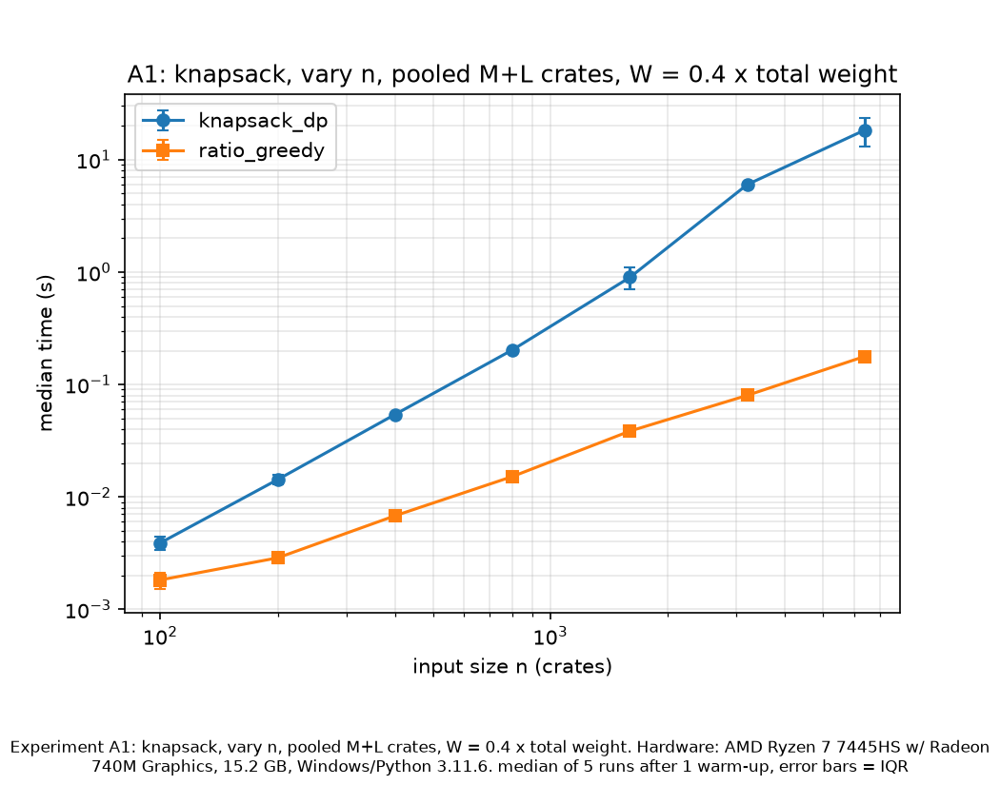
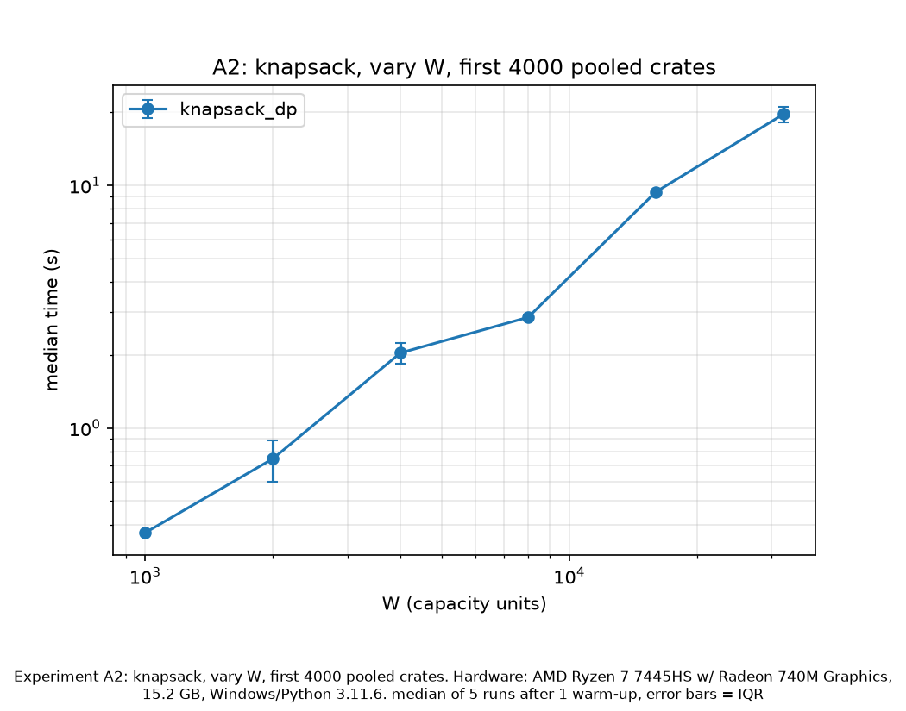
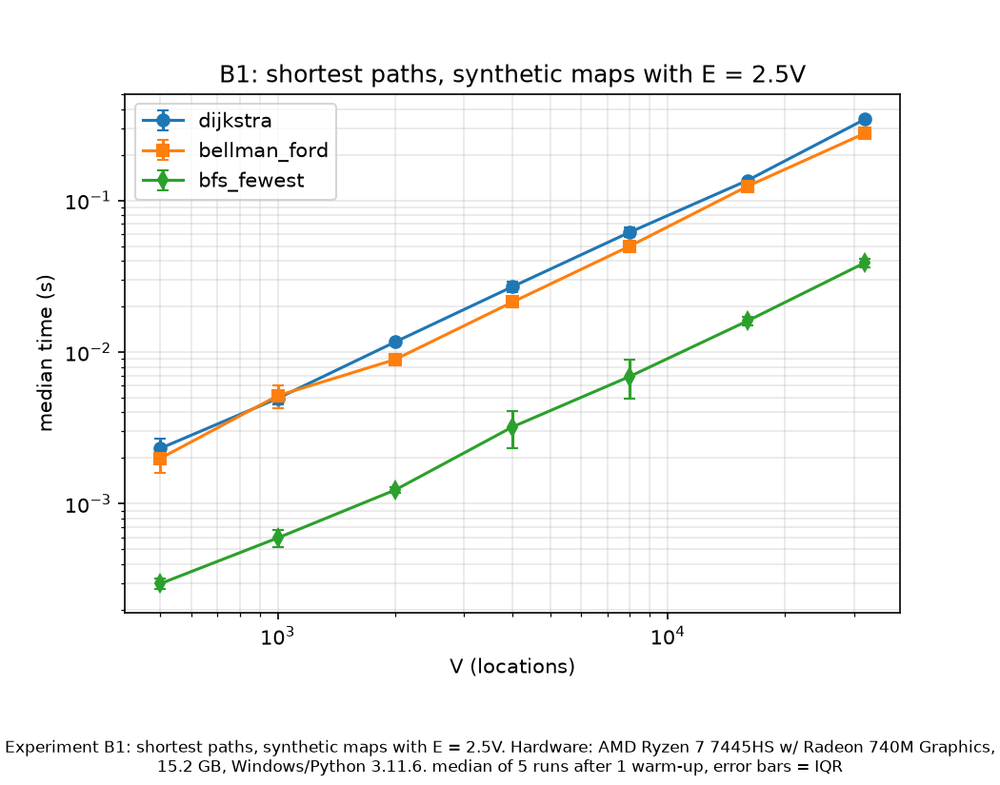
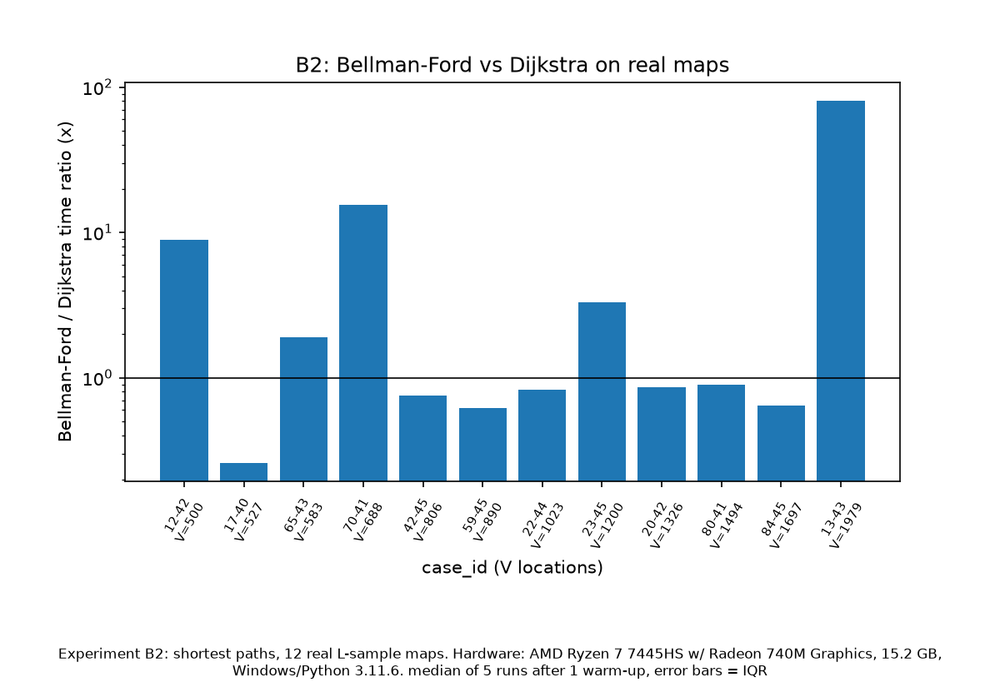
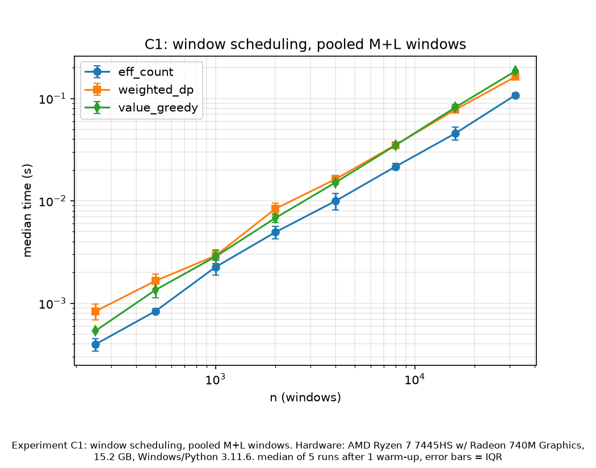
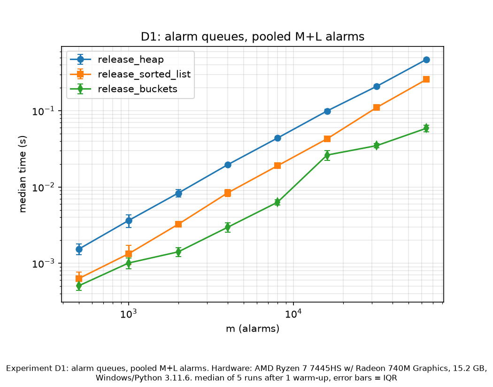
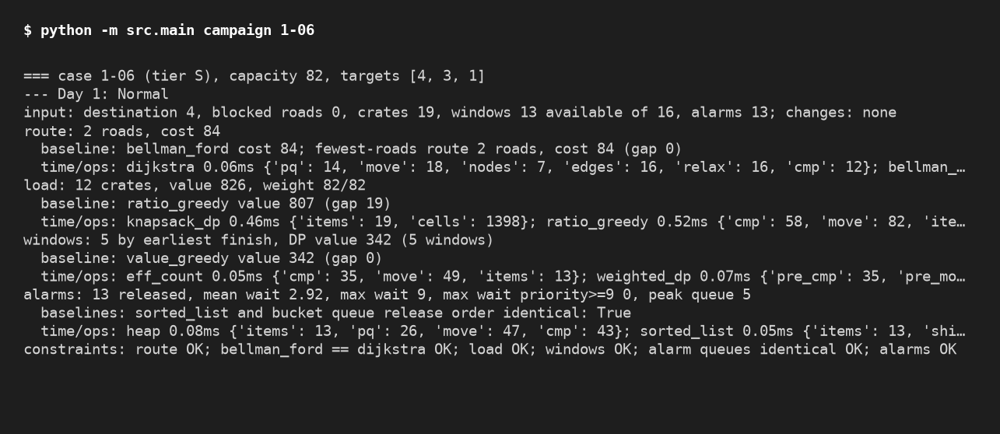
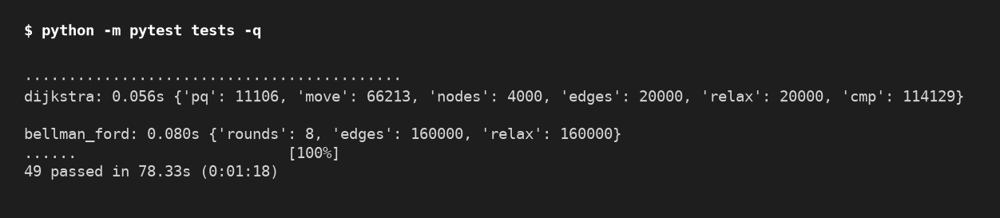
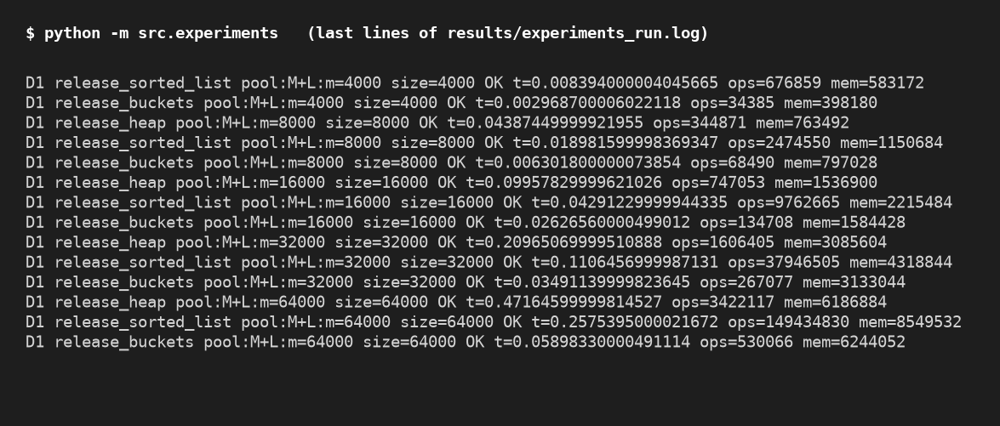

# LIFELINE — Algorithmic Relief-Command Engine
## Final Project Report (draft 1)

Design and Analysis of Algorithms · BS Data Science and Artificial Intelligence · FAST-NUCES Islamabad
Group 69: Muhammad Umar (22I-0644), Haider Ali (22I-0502), Awwab Ahmed (23I-0079) — all Section AI-A

### Abstract
This report describes the engine that group 69 built for Operation LIFELINE, a relief command operating after a flood, an earthquake or a cyclone in a river delta. The engine answers four operational decisions with algorithms the group implemented from first principles: which crates to load on the truck (0/1 knapsack dynamic programming against a value-per-kilogram greedy rule), which route to drive on a map whose roads close in waves (Dijkstra's algorithm with the group's own binary heap, against Bellman–Ford and a fewest-roads search), which rescue windows to staff (earliest-finish-first and weighted interval scheduling, against a highest-value-first rule), and which alarm to answer first (a binary heap against a sorted list and a bucket queue). All inputs come from the course master dataset (release master_release_v1, 3,622 cases from 75 groups), from which the group's sample is drawn by its seed 69. The modules are verified against the exhaustive-search optima of 204 small cases, against brute force and Floyd–Warshall on random inputs, against invariants on every output, and by four injected faults that the test suite must detect. Six experiments measure time, operations and memory over at least five geometrically spaced sizes, and a seven-day campaign combines all four modules on five cases, including two deliberately hostile trap cases. All 113 measured points finished within the five-minute limit. The exact methods were affordable at every tested size (the largest knapsack, 6,400 crates, took 18 s), the measured growth rates matched the predicted ones in 18 of 23 checks, and the misses were instructive: Bellman–Ford beat Dijkstra on the synthetic maps, its cost relative to Dijkstra on real maps varied more than 200-fold with the numbering of locations, and the bucket queue beat the binary heap at every size. The campaign ran 35 days with zero failed constraint checks; 12 trips were impossible because closures cut off the destination.

### 1. Introduction
The LIFELINE project asks a three-person team to treat a relief operation as a sequence of computational problems. Every day the command must decide what to load, where to drive, which rescue windows to staff and in which order to answer alarms, while roads close in waves and the value of supplies changes with events such as a storm or a medical emergency. The project prescribes no algorithms: each group recognises the problem behind each decision, selects and justifies algorithms, implements them, and evaluates them on shared data.

The first iteration produced the group's 50 synthetic cases, a validator and an algorithm-selection report. The course staff merged the cases of all groups into the master dataset, which is the only data used here. This report covers the second iteration: implementation, testing, experiments and the integrated seven-day campaign.

The report is organised as follows. Section 2 describes the data. Section 3 defines each problem and the algorithms selected for it. Section 4 presents the architecture. Section 5 describes testing, Section 6 the experiments, and Section 7 the campaign. Section 8 shows the program's output, Section 9 gives the recommendation to the lead designer, Section 10 the limitations and conclusions, Section 11 the division of work, and Section 12 the references.

### 2. Data
**Case studies.** The master dataset combines six case studies: a delta flood (flat villages, roads under water in waves, food and water first), a mountain earthquake (few roads, medicine and tools, bursts of urgent calls), a coastal cyclone (shelters, overlapping rescue windows, noisy radio), an urban flash flood (dense roads, very high alarm rate, rare equipment), a landslide corridor (a single highway whose collapse cuts off communities) and an outbreak camp (perishable supplies, repetitive beacons). Every case is graded by size: tier S (small enough for exhaustive search), M, L and the hostile tier X trap cases 46–49.

**Master dataset.** Release master_release_v1 (12 November 2026) holds 3,622 cases from 75 groups (S 1,429; M 1,461; L 440; X 292) in one CSV file per table. The engine checks the SHA-256 checksum of all 20 files before use (`python -m src.main verify`); the checksums are recorded in `data/MASTER_VERSION.md`. Several tables exceed one million rows, so the loader streams each CSV once and keeps only the requested cases.

**Sample.** Following the rulebook, a sample of a tier consists of the cases at positions s mod 7, s mod 7 + 7, … in master order, with s = 69 (positions 6, 13, 20, …). Table 1 lists the sample sizes.

*Table 1 — Sample drawn with seed 69.*

| Tier | Cases in master | Cases in sample | First cases |
|---|---:|---:|---|
| S | 1,429 | 204 | 1-06, 1-13, 2-00 |
| M | 1,461 | 208 | 1-26, 1-33, 2-20 |
| L | 440 | 62 | 2-40, 3-41, 4-42 |
| X | 292 | 41 | 2-48, 4-47, 7-46, 8-49 |

**Pooled and synthetic instances.** Experiments need inputs larger than one case. Crates, windows and alarms are pooled from consecutive sample cases (tiers M then L) exactly as the rulebook prescribes: crates are appended, the windows of the i-th case are shifted by 1,440·i minutes, alarm ticks are shifted past the last tick of the previous case, and ids are renumbered from 1. Networks are never pooled; the map experiment uses synthetic connected graphs built from the seed string `69-synth-<V>` (a random spanning tree plus extra roads up to E = ⌊2.5V⌋, minutes uniform in 1–60, penalties from {0, 1, 2, 4, 6}).

**Data observation.** 1,862 of the 3,622 cases number their closure waves from 1 rather than 0. The rulebook defines "wave i" as wave (i mod number of waves); the engine therefore interprets wave i as the i-th wave of the case in increasing `wave_no` order, which is correct for both conventions.

### 3. Algorithm selection and design
The step cost u → v is minutes(u, v) + penalty(v); costs are therefore directed. Every ordering is total: ties are broken by id ascending. Value-per-kilogram ratios are compared exactly by cross-multiplication. All four selections of the Iteration 1 proposal are **retained**; the only addition is the bucket queue for module D, which the proposal named as a candidate "which we will test".

#### 3.1 Module A — Relief inventory
*Problem.* Given n crates with integer weights wᵢ ∈ [1, 20] and values vᵢ (after the day's multiplier) and capacity W, choose indivisible crates of total weight at most W with maximum total value.
*Primary — 0/1 knapsack DP.* One value row best[0..W] is updated item by item from high capacities to low; a keep-bit row per item records whether the item improved best[c], and the chosen set is rebuilt by walking the items backwards. Time O(nW), memory O(W) values plus n·(W+1) keep bytes.
```
for each item (w, v):
    for c = W down to w:  if best[c-w] + v > best[c]: best[c] = best[c-w] + v; keep[item][c] = 1
rebuild: c = W; for items in reverse: if keep[item][c]: take item; c -= w
```
*Baseline — ratio greedy.* Sort by value/weight descending (ties: crate id) with the group's merge sort and take each crate that still fits; O(n log n), not optimal.
*Why.* Weights are small integers and W ≤ 0.7 · 20n, so the pseudo-polynomial DP is exact and feasible (n·W ≤ 5.5·10⁷ on the largest master case: 3,000 crates, capacity up to 19,568). The trap cases 47 make the greedy reach at most 60% of the optimum.

#### 3.2 Module B — Route planning
*Problem.* Given V locations, E roads, the HQ (location 0) and today's blocked roads, find a cheapest route to the destination and its cost or report "no route"; also the set of reachable locations and the fewest-roads route found by exploring level by level with neighbours in ascending id.
*Primary — Dijkstra's algorithm* with the group's binary heap and lazy deletion, O((V+E) log V), valid because every step cost is at least 1. *Breadth-first search* gives reachability and the fewest-roads route in O(V+E).
```
dist[src] = 0; push (0, src)
while heap: (d, u) = pop; if d > dist[u]: continue
    for (v, c) in adj[u]: if dist[v] undefined or d + c < dist[v]: dist[v] = d + c; parent[v] = u; push (dist[v], v)
```
*Baselines.* Bellman–Ford with early exit (O(VE) worst case, O(rounds · E) in practice) for the cost; the fewest-roads route, re-costed, to measure the price of ignoring costs.
*Why.* Costs are positive and maps sparse (E ≤ 3V). Trap 48 cases make every fewest-roads route cost at least 1.5 times a cheapest route.

#### 3.3 Module C — Rescue scheduling
*Problem.* Given n windows with start < finish (minutes) and a value, choose pairwise compatible windows (one finishes at or before the other starts) with the most windows, or with the most total value. On day d a window is unavailable when (id + d) mod 5 = 0.
*Primary.* Earliest-finish-first greedy for the count, O(n log n), exact. Weighted interval scheduling for the value: sort by finish; p(j) = the number of windows finishing at or before start j, found by binary search; dp[j] = max(dp[j−1], dp[p(j)] + value_j); O(n log n).
*Baseline.* Highest-value-first greedy, keeping chosen windows ordered by start and checking only the two neighbours of each candidate.
*Why.* Times are integers in 0–1,440 and ties are broken by id, so the result is deterministic. Dense overlaps (case study 3) defeat the value greedy.

#### 3.4 Module D — Emergency queue
*Problem.* Given m alarms (tick, priority 1–10, id) sorted by tick, release one alarm per tick, always the most urgent waiting alarm (priority descending, then tick ascending, then id ascending), until all are released.
*Primary.* The group's binary heap keyed (−priority, tick, id): O(log q) per operation, O(m log m) in total.
*Baselines.* A list kept sorted so the most urgent alarm is last (binary search for the position, `list.insert` shifts the tail): O(q) shifts per insertion. A bucket queue of ten FIFO queues, one per priority; input order already breaks ties within a priority, so each operation is O(10).
*Why.* At 1.2–1.8 arrivals per tick against one release per tick the backlog grows to thousands. With only ten priority levels the bucket queue is a strong competitor.

### 4. System design and implementation
*Figure 1 — Architecture and data flow.*
```
 Master CSVs ──► loader (checksums, sample, pooling) ──► validation layer ──► modules A B C D ──► campaign coordinator ──► results/campaign_*
                                         │                                     ▲
                                         └──────────► experiment runner ────────┘──► results.csv ──► analysis ──► fits.csv, plots/
```
The code is a Python 3.11 package `src/` with narrow interfaces. `loader.py` verifies checksums, draws the sample, pools inputs and builds synthetic maps. `validation.py` is the trust boundary: it raises `InvalidInput(case, rule, detail)` before any algorithm runs (for example, a crate of weight 0 or a road to a missing location), and the coordinator reports the problem instead of producing a plausible but invalid answer. `heap.py` and `sorting.py` implement the binary heap and merge sort used by the modules, with operation counters; the evaluated algorithms use no library priority queue, binary search or sort. The four module files expose pure functions on tuples. `campaign.py` plays the seven days, `experiments.py` measures, and `analysis.py` fits growth curves and draws the plots. One command runs everything: `python -m src.main all`.

Infeasible situations are handled explicitly: an unreachable destination skips the trip (no route, no loading) and is reported as "no route"; a capacity below every crate weight gives an empty load; a tick with no waiting alarm releases nothing.

### 5. Testing
The test suite (`python -m pytest tests -q`, 49 tests) has five layers.

1. **Unit and boundary tests** per module: empty inputs, capacity 0, crates heavier than the truck, touching windows, identical windows, a destination equal to the source, unreachable locations, all alarms at tick 0, and every tie rule.
2. **Reference tests.** The knapsack DP equals `cargo_opt`, and earliest-finish-first and the interval DP equal `window_count_opt` and `window_value_opt`, on all 204 tier-S cases of the sample (these optima were computed by exhaustive search). Brute force over all subsets checks the knapsack and scheduling modules on 300 random small inputs each; Dijkstra, Bellman–Ford and Floyd–Warshall agree on 200 random maps; the three alarm queues and an independent simulator give identical orders on 300 random streams and on 25 master cases.
3. **Trap tests.** On every trap-47 case in the X sample the greedy loads at most 60% of the DP value; on every trap-48 case the fewest-roads route costs at least 1.5 times the cheapest.
4. **Invariants** on every output, also checked by the campaign every day: routes use open roads and their cost re-sums; loads respect the capacity; scheduled windows are compatible and available; every alarm is released once, after its arrival, one per tick, most urgent first.
5. **Fault injection.** Four deliberate faults are injected from `tests/faults.py` without touching the production code, and the suite must fail on each: (i) touching windows treated as incompatible — 3 scheduling tests fail (brute force, tier-S claims, touching case); (ii) the alarm key ignores the tick — caught only by a test added for this purpose; (iii) route building ignores blocked roads — 1 route test fails (the blocked-road test); (iv) a knapsack that can reuse a crate — 3 inventory tests fail. Every failure is an assertion on a wrong answer (for example, a destination that should be unreachable got a distance of 5).

A first version of the blocked-road fault called the patched function itself and crashed with infinite recursion, so all 8 route tests "failed" for the wrong reason; it was corrected so that each fault is detected by a genuine assertion. Only one test detects the blocked-road fault, which marks that area for more tests.

The tie-rule fault was initially **not** detected: in every original alarm test the ids increased with the tick, so a key that skips the tick behaved identically. A test with ids out of tick order now detects it. This is the main lesson of the fault-injection exercise: tests must vary the attributes that a tie rule distinguishes. All 49 tests pass (`results/fault_injection.txt` records the four fault runs).

### 6. Experiments and analysis
**Method.** Each point runs in a fresh process: one counted run discarded as a warm-up, then five timed runs with `time.perf_counter` (single thread, data loading excluded); the median and interquartile range are reported. Memory is the peak traced by `tracemalloc` in a separate run, beyond the input. A run longer than five minutes is recorded as DNF. Growth is fitted by least squares on log–log axes; Table 2 gives the slope with its 95% confidence interval, R² and the error of predicting the largest size from the others. Hardware: AMD Ryzen 7 7445HS, 15.2 GB RAM, Windows 11, Python 3.11.6. Predictions were committed to `prediction_log.md` before the run.

*Table 2 — Fitted growth (log–log least squares; time unless stated).*

| Exp | Algorithm | Points | Slope | 95% CI | R² | Hold-out error |
|---|---|---:|---:|---|---:|---:|
| A1 (n) | knapsack_dp | 7 | 2.075 | 1.94–2.21 | 0.997 | 3.4% |
| A1 (n) | ratio_greedy | 7 | 1.140 | 1.06–1.23 | 0.996 | 4.1% |
| A2 (W) | knapsack_dp | 6 | 1.146 | 0.97–1.32 | 0.988 | 8.7% |
| A2 (W) | knapsack_dp, ops | 6 | 1.002 | 1.001–1.003 | 1.000 | 0.3% |
| B1 (V) | dijkstra | 7 | 1.200 | 1.17–1.23 | 1.000 | 8.7% |
| B1 (V) | bellman_ford | 7 | 1.180 | 1.11–1.25 | 0.998 | 6.8% |
| B1 (V) | bfs_fewest | 7 | 1.182 | 1.13–1.24 | 0.999 | 10.2% |
| C1 (n) | eff_count | 8 | 1.146 | 1.10–1.19 | 0.999 | 0.7% |
| C1 (n) | weighted_dp | 8 | 1.104 | 1.05–1.16 | 0.998 | 0.1% |
| C1 (n) | value_greedy | 8 | 1.197 | 1.18–1.21 | 1.000 | 0.3% |
| D1 (m) | release_heap | 8 | 1.178 | 1.16–1.20 | 1.000 | 7.1% |
| D1 (m) | release_sorted_list | 8 | 1.249 | 1.22–1.28 | 1.000 | 1.5% |
| D1 (m) | release_sorted_list, ops | 8 | 1.918 | 1.88–1.96 | 1.000 | 9.8% |
| D1 (m) | release_buckets | 8 | 1.040 | 0.89–1.19 | 0.979 | 25.6% |


*Figure 2 — A1: knapsack DP and ratio greedy, time against the number of crates.*


*Figure 3 — A2: knapsack DP, time against the capacity W at n = 4,000.*

**A — inventory.** The DP's time grows with slope 2.08 when the capacity grows with the number of crates (W = 0.4 · total weight), as the O(nW) bound predicts; its cell count grows with slope 1.98. At 6,400 crates it took 18.35 s and 166.7 MB. With n fixed at 4,000 (A2) the cell count is exactly linear in W (slope 1.002) but the time is not (slope 1.15): the per-cell cost rose from about 0.08 µs to 0.15 µs as the keep table grew to 132 MB, a memory effect rather than an algorithmic one. The ratio greedy is about 100 times faster and, on random pooled crates, within 0.04% of the optimum — the DP's advantage only matters on adversarial inputs such as trap 47.


*Figure 4 — B1: Dijkstra, Bellman–Ford and BFS on synthetic maps (E = 2.5V).*


*Figure 5 — B2: Bellman–Ford / Dijkstra time ratio on 12 real maps of the L sample.*

**B — routes.** On synthetic maps all three methods grew almost linearly (slopes 1.18–1.20), and Bellman–Ford with early exit was slightly *faster* than Dijkstra (0.278 s vs 0.343 s at V = 32,000) after only 11 rounds. Two causes were identified after the run: interpreted heap operations cost more than plain relaxations, and the synthetic generator attaches each node to a parent with a smaller id, so Bellman–Ford's ascending scan settles most distances in its first pass. On 12 real maps (B2) the ratio ranged from 0.3 (a corridor numbered along the road, 2 rounds) to 80.8 (map 13-43, 525 rounds). Dijkstra's time does not depend on the numbering, which is the decisive property for a system that must answer within a bound.


*Figure 6 — C1: earliest-finish-first, weighted interval DP and value greedy on pooled windows.*

**C — scheduling.** All three methods grow as n log n (slopes 1.10–1.20). The value greedy's list shifts grow with slope 1.69, but they are fast memory moves, so its time slope stays at 1.20. Its value is only 69.5–70.6% of the optimum on pooled windows.


*Figure 7 — D1: binary heap, sorted list and bucket queue on pooled alarms.*

**D — alarm queues.** Theory ranks the heap above the sorted list for large backlogs, yet the sorted list was faster at every size (heap/list ratio 2.73 at m = 1,000 falling to 1.83 at m = 64,000), while its shift count grew quadratically (slope 1.92, 149 million shifts at 64,000). The ratio is falling, so the heap should win at some larger size, which was not reached. The bucket queue was fastest everywhere (0.059 s at 64,000) because ten priority levels make every operation constant-time.

**Prediction log.** 18 of 23 predictions were within tolerance. The misses — Bellman–Ford against Dijkstra (B1, B2) and A2's time against W — are analysed in `prediction_log.md`.

### 7. Campaign results
The campaign plays seven days on five cases from the sample: 1-06 (tier S), 1-26 (M), 2-40 (L), 2-48 (X, the shortest-looks-cheapest trap) and 4-47 (X, the best-looking-crate trap). *Table 3 — Campaign summary (35 days).*

| Case | Tier | Trips made | Load value: DP vs greedy | Route cost: fewest-roads vs Dijkstra | Window value Day 1: DP vs greedy | Alarm wait mean / max (ticks) | Failed checks |
|---|---|---:|---|---|---|---|---:|
| 1-06 | S | 5 / 7 | 826 vs 807 (Days 1, 4, 5) | equal except Day 3: 114 vs 91 | 342 vs 342 | 2.9 / 9 | 0 |
| 1-26 | M | 6 / 7 | 2,258 vs 2,257 (Day 1) | Day 2: 368 vs 216; Day 3: 72 vs 25 | 2,140 vs 1,839 | 103 / 624 | 0 |
| 2-40 | L | 1 / 7 | 16,871 vs 16,865 (Day 1) | equal (Day 1 only) | 3,613 vs 2,393 | 377 / 2,023 | 0 |
| 2-48 | X | 5 / 7 | 19,164 vs 19,159 (Day 1) | Days 1 and 7: 64 vs 12; Day 4: 68 vs 22 | 3,769 vs 2,044 | 378 / 2,041 | 0 |
| 4-47 | X | 6 / 7 | 198 vs 113 (Days 1–4, 6); 198 vs 139 (Day 5) | equal | 2,019 vs 415 | 371 / 2,968 | 0 |

Every constraint check passed on all 35 days. Twelve trips were skipped because closures cut off the destination; the corridor case 2-40 could reach its destination only on Day 1. **Deliberately difficult scenarios.** On 4-47 (trap 47) the obvious rule of loading the best value per kilogram first takes a light lure crate and one of two heavy crates, and then nothing fits: 113 value units instead of 198 (57%); the DP finds the pair. Day 5's tripled medicine values weaken the trap (70%), which shows that the trap is defined on base values. On 2-48 (trap 48) the route with the fewest roads passes a penalty-6 junction and costs 64 against 12 for the cheapest route (5.3 times). The remaining limitation is that exactness costs memory: the DP needs n·(W+1) bytes, and Dijkstra is only correct for non-negative costs. Alarm waits are long on the large cases (means of 371–378 ticks) because arrivals exceed the one-release-per-tick capacity; priority 9 and 10 alarms waited at most 3 ticks.

### 8. Screenshots of outputs and interface

*Figure 8 — `python -m src.main campaign 1-06`: Day 1 of the campaign (input, decisions, baseline comparison, constraints checked).*


*Figure 9 — `python -m pytest tests -q`: the full test suite.*


*Figure 10 — `python -m src.experiments`: progress lines of the experiment runner (last measured points).*

The engine has a command-line interface only; no graphical interface was built in this draft.

### 9. Recommendation
Addressed to the lead designer of the relief command (the README gives every assumption and measurement in full).

- **Inventory: ship the knapsack DP.** It is exact and took 18 s at 6,400 crates (A1). The greedy is within 0.04% on random loads but loaded 57% of the best value on trap 47. It depends on n·W staying moderate; when the n·(W+1)-byte table no longer fits in memory or the time exceeds the planning window, switch to the greedy.
- **Routes: ship Dijkstra.** It took 0.34 s at 32,000 locations (B1), and its cost does not depend on how locations are numbered, while Bellman–Ford ranged from 0.3× to 80.8× on real maps (B2). It depends on non-negative step costs; the validation layer's minimum-cost check tells the designer when that breaks.
- **Scheduling: ship earliest-finish-first and the weighted interval DP.** Exact, 0.16 s at 32,000 windows (C1); the value greedy reached about 70%. It assumes one crew; the number of crews per day is the measurement that would invalidate it.
- **Alarms: ship the bucket queue.** Fastest at every size (0.059 s at 64,000, D1) with identical output. It depends on ten integer priority levels and in-order arrivals; the number of distinct priorities and an order check of the stream tell when to fall back to the binary heap.

*Ranked failure modes:* (1) destinations cut off by closures (12 of 35 trips skipped); (2) the alarm backlog when arrivals exceed one per tick (mean waits of about 375 ticks on the large cases); (3) exact methods that stop scaling (DP memory n·(W+1) bytes; Bellman–Ford on badly numbered maps).

### 10. Limitations and conclusion
*What does not work or is not shown.* The synthetic maps of B1 favour Bellman–Ford because node ids follow the spanning tree; a shuffled-id rerun is the first follow-up. Timings are those of interpreted Python, where constant factors decided D1 and B1 within the tested range. The A1 timings at 1,600 and 6,400 crates have a large spread. No graphical interface was built. The wave-numbering interpretation (Section 2) has not been confirmed by the course staff.

*What could be improved.* A divide-and-conquer reconstruction would cut the DP's memory from n·W bytes to O(W); a bucket-based queue could replace the binary heap inside Dijkstra, since costs are small integers; larger alarm streams would locate the heap/list crossover.

*What the group learned.* Operation counts and asymptotic bounds predicted growth rates well (most fitted slopes fell inside the predicted intervals), but they did not predict which method is fastest at a given size: in Python the cost of an operation varies by an order of magnitude between a C-level list shift and an interpreted heap sift. The instance generator itself can bias an experiment (B1), and the shape of the input — how locations are numbered, how many priority levels exist — can matter more than its size. Fault injection showed that a test suite can pass while missing a tie rule unless the tests vary exactly the attribute that the rule decides.

### 11. Work division
*Table — Work division across modules, test suites, experimental evaluations, and reporting.*

| Member | Modules | Tests | Experiments | Report sections |
|---|---|---|---|---|
| Muhammad Umar (22I-0644, AI-A) | Module A (Relief Inventory: 0/1 knapsack DP and greedy value-ratio in `src/inventory.py`), Module D (Emergency Queue: priority release loop, 10-bucket FIFO queue and sorted list in `src/alarms.py`), Phase 1 generator (`generator/`) | Unit tests for knapsack DP (`tests/test_inventory.py`), unit tests for alarm dispatch priority models and tie-rules (`tests/test_alarms.py`) | Experiments A1 and A2 (Knapsack scaling vs capacity and item count), Experiment D1 (Priority heap vs bucket queue vs sorted list) | Section 3.1 (Module A — Relief Inventory), Section 3.4 (Module D — Emergency Queue), Section 6 (Experiments A1, A2 and D1) |
| Haider Ali (22I-0502, AI-A) | Pre-execution validation layer (`src/validation.py`), Module C (Rescue Scheduling: Earliest-Finish-First greedy and Weighted Interval Scheduling DP with binary search in `src/scheduling.py`) | Rescue window interval scheduling unit tests (`tests/test_scheduling.py`), algorithmic fault mutants (`tests/faults.py`), dynamic fault injection verification test harness (`tests/test_fault_injection.py`), `tests/conftest.py` dynamic monkey-patching harness | Statistical analysis regression engine (OLS log-log fitting with Student's t 95% confidence intervals, R² goodness-of-fit in `src/analysis.py`), scaling plots generation (`results/plots/`), Experiment C1 (Interval scheduling scaling) | Section 2 (Data), Section 3.3 (Module C — Rescue Scheduling), Section 5 (Verification and Fault Injection), Section 6 (Experiment C1 and Statistical Methodology), Section 8 (Program Output), Section 11 (Work Division), Report build pipeline (`docs/build_report.py`) |
| Awwab Ahmed (23I-0079, AI-A) | Algorithmic foundations (binary min-heap `src/heap.py`, instrumented stable merge sort `src/sorting.py`), streaming master dataset loader and checksum verification (`src/loader.py`), Module B (Route Planning: Dijkstra with min-heap, Bellman-Ford with early termination, BFS fewest roads in `src/routes.py`), 7-day disaster relief campaign simulation engine (`src/campaign.py`), unified CLI driver (`src/main.py`) | Foundation unit tests for heap invariant, empty pops and merge sort stability (`tests/test_foundation.py`), network routing and shortest path invariant tests (`tests/test_routes.py`), 7-day campaign multi-scenario integration tests (`tests/test_campaign.py`), multiprocessing benchmark runner tests (`tests/test_experiments.py`) | Multiprocessing benchmark execution framework with timeout isolation and memory tracing (`src/experiments.py`), Prediction log hypothesis pre-registration and retrospective discrepancy analysis (`prediction_log.md`), Experiments B1 and B2 (Shortest path scaling on synthetic and real maps) | Abstract, Section 1 (Introduction), Section 3.2 (Module B — Route Planning), Section 4 (Architecture), Section 6 (Experiments B1 and B2), Section 7 (The 7-Day Campaign), Section 9 (Recommendation to Lead Designer), Section 10 (Limitations and Conclusions) |

*AI assistance.* AI tools were used to draft code, tests and this report; every decision and its reason is recorded in a separate decision log kept outside the repository, as the course's AI policy requires.

### 12. References
1. T. H. Cormen, C. E. Leiserson, R. L. Rivest and C. Stein. *Introduction to Algorithms*, 4th ed. MIT Press, 2022. (Dynamic programming, binary heaps, Dijkstra, Bellman–Ford, merge sort.)
2. J. Kleinberg and É. Tardos. *Algorithm Design*. Pearson, 2005. (Interval scheduling, weighted interval scheduling, knapsack.)
3. E. W. Dijkstra. A note on two problems in connexion with graphs. *Numerische Mathematik* 1, 269–271, 1959.
4. R. Bellman. On a routing problem. *Quarterly of Applied Mathematics* 16, 87–90, 1958.
5. H. Kellerer, U. Pferschy and D. Pisinger. *Knapsack Problems*. Springer, 2004.
6. Course staff. LIFELINE master dataset, release master_release_v1, README and CHECKSUMS, 12 November 2026.
7. Python Software Foundation. Python 3.11 documentation: `time.perf_counter`, `tracemalloc`, `multiprocessing`, `statistics`.
